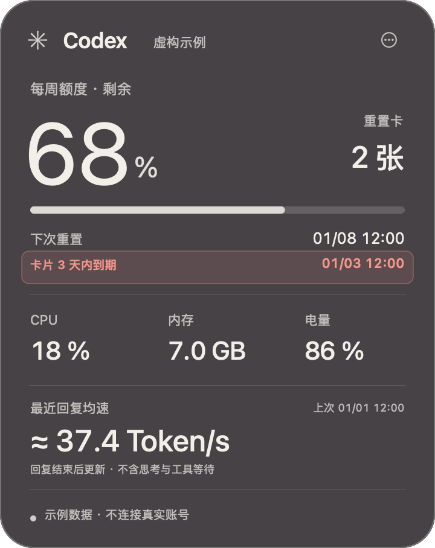
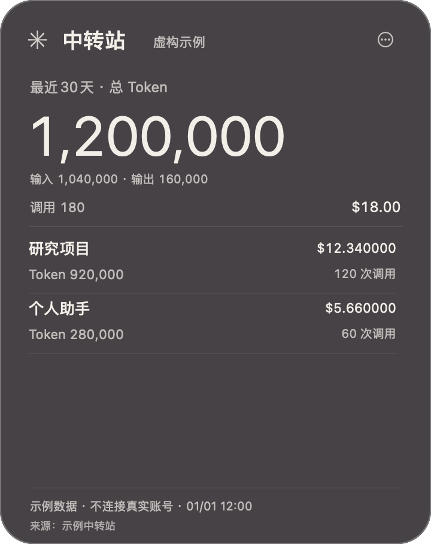
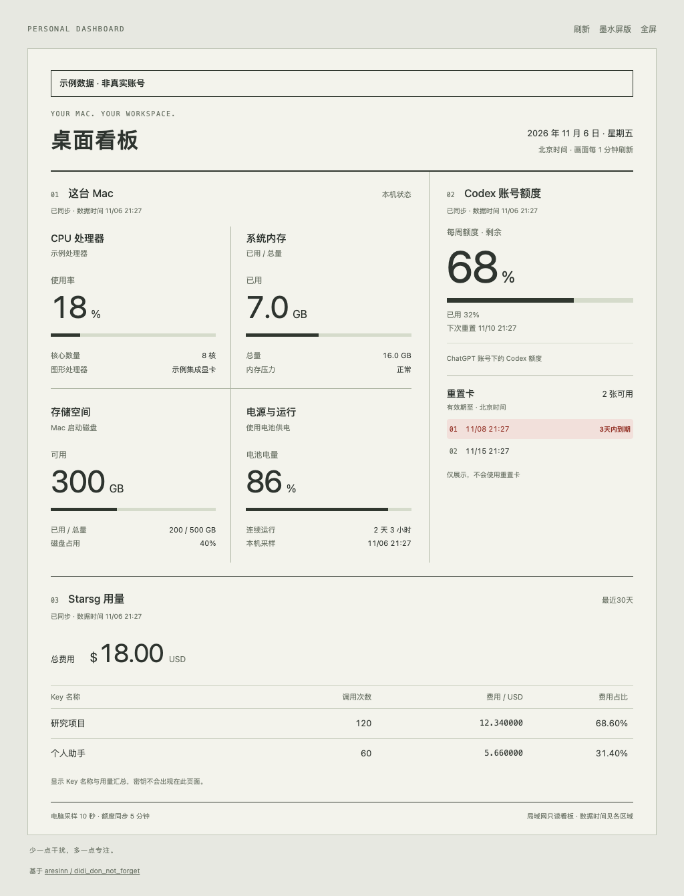
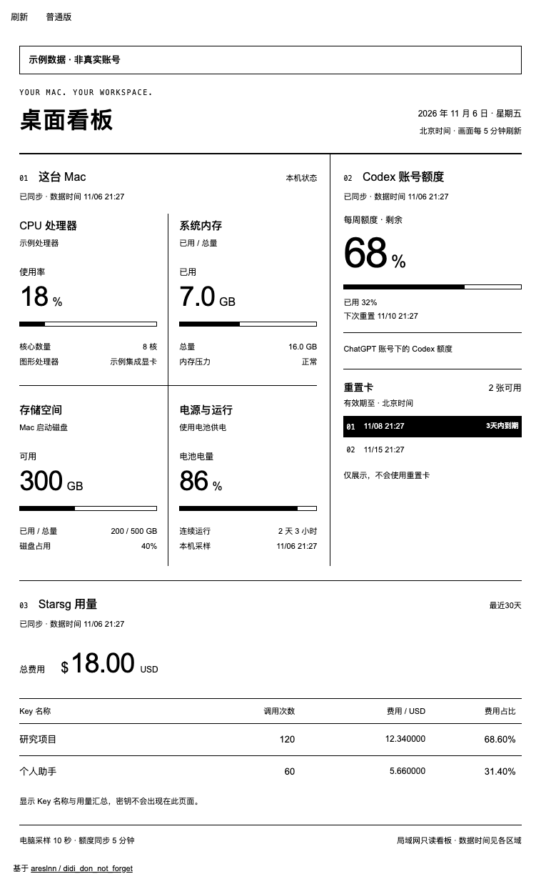

# didi_don_not_forget

把 AI 用量放在 Mac 桌面。独立的原生桌面卡片显示 Codex 额度和你配置的中转站用量，也能把只读页面放到 iPad、Kindle 或其他浏览器设备上。

**作者：[@areslnn](https://github.com/areslnn)。源码可见，非商业使用可修改和分享；商业使用须事先书面授权，向他人分发或通过网络提供的衍生版本必须提供对应源码并沿用许可。详见 [LICENSE](LICENSE)。本项目不是 MIT/GPL，也不属于 OSI 定义的开源软件。**

## Mac 原生桌面小组件

关闭“始终置顶”后，卡片留在普通桌面空间，不再跟随全屏应用或强制前置。开启时才允许跨空间悬浮。

**Codex 回复速度：** 卡片新增“最近回复均速”，自动跟随本机最近活跃的 Codex 根对话。读取本地日志的分段时间与 Token 计数，排除思考与工具等待。这是回复完成后更新的近似均速，不是逐 Token 实时速度；中转站不测速。

测速每秒增量检查，最多跟踪最近的 24 个根对话，旧对话继续使用也可被发现。只采纳能够明确配对的单段纯文字回复；带工具、多段、缺失用量或时间异常的响应不计入。没有新样本时保留上次可测值和原时间。不同 Codex 日志版本可能缺少必要字段。输出计数可能包含格式标记，因此速度以“≈”标注。当前仅在 Mac 卡片及本机接口提供，不向局域网副屏提供。

应用使用 **AppKit 原生桌面卡片**，可拖动、分别隐藏、记忆位置和切换置顶，通过菜单栏管理。它是独立运行的 Mac 应用，**不是 macOS WidgetKit 系统组件选择器中的小组件**。

下图来自原生应用的虚构示例模式，未使用真实账号数据。

<p>
  
  
</p>

- **Codex 额度**：读取当前 Mac 上已登录的 Codex 账号，展示平台实际返回的额度窗口、剩余比例、重置时间及可用重置卡。
- **到期提醒**：重置卡剩余不超过 72 小时会突出显示。只展示，不使用卡片。
- **中转站用量**：自行配置站点的统计 API 或兼容的网页模板，展示真实 Token、调用次数、费用和每个 Key 的明细。来源名称由你设置，不绑定某个品牌。
- **Mac 状态**：CPU、内存、磁盘、电源等可取得的指标；没有可靠来源的数值保持“—”。
- **浏览器副屏**：同一局域网内，输入连接码后查看只读页面；提供不依赖 JavaScript 的墨水屏版本。

这是独立项目，不是 OpenAI、Anthropic、Apple、Amazon 或任何中转站的官方产品。Codex 额度不是 ChatGPT 网页聊天额度；中转站统计也不是模型厂商的官方订阅额度。

## 从源码运行

目前采集端支持 **macOS 14 或更新版本**，需要 Python 3.9+ 和 Xcode Command Line Tools 中的 Swift 编译器。构建脚本使用本机架构；已进行的本地验证以 Apple Silicon 为准，其他机器仍应自行验证。

```bash
git clone https://github.com/areslnn/didi_don_not_forget.git
cd didi_don_not_forget
zsh scripts/build-macos.sh
open "build/AI Usage Dashboard.app"
```

脚本只在项目的 `build/` 中构建应用，不覆盖其他应用，不更改开机启动项。构建产物使用本机临时签名，未进行 Apple 公证；本仓库主要分发源码。

要显示 Codex 额度，先安装并登录支持 `app-server` 的 Codex 桌面应用或 CLI。中转站默认不连接任何网站，在组件菜单中打开 **“中转站设置…”** 后自行配置。

## 配置中转站

两种连接方式都有适配边界，不能仅填写任意网站首页就自动取得用量。

### API JSON（推荐）

使用站点提供的 **HTTPS 只读统计接口**。应用发送 GET 获取 JSON，不调用模型生成接口。设置统计接口 URL、显示名称、周期标签及字段映射；需要认证时，在专用凭据框填写 Bearer token，凭据保存在本机钥匙串，不写入配置文件或副屏页面。

字段可映射为名称、调用次数、输入 Token、输出 Token、总 Token 和美元费用。支持对象点路径和数字数组索引；`entriesPath` 为空表示响应根节点就是列表。完整例子见 [字段映射与数据契约](docs/providers.md)。

请注意：

- **Token 必须来自真实统计。** 优先使用有效的总 Token；只有输入和输出都明确提供时，适配器才可相加。不会用费用、额度或积分反推 Token。
- **缺失不等于 0。** 某个 Key 缺少总 Token 时，整体 Token 合计显示“未提供”，其他已知明细仍可查看。调用次数和费用也分别检查完整性。只有成功返回的空列表才能确认零合计。
- **金额映射必须是美元。** 不要把 `quota`、积分、余额点数或其他货币直接映射为 `amountUSD`。
- **名称映射使用昵称或别名。** 不要把 `api_key`、`token`、`secret` 等原始密钥字段映射为显示名称；名称会显示在桌面卡片及配对的副屏上。
- **周期标签不会改变请求范围。** 标“最近30天”时，URL 的查询参数或接口本身也必须返回同一周期，不能给累计统计贴上不同周期的标签。
- URL 不接受用户信息、片段或常见凭据查询参数。认证信息应放在专用凭据框，不应写在 URL 中。

### 网页统计模板

适合没有可用统计 API、且网页符合现有 **按 API Key 汇总调用次数与费用** 模板的站点。设置完整 HTTPS 统计页面 URL、名称和周期后，在应用自己的窗口内登录。

这不是任意网站通用抓取器。域名、路径、查询参数、周期控件和页面统计结构必须匹配；站点改版可能使模板失效。当前网页模板只读取调用和费用，**不提供 Token 统计**，所以 Token 显示“未提供”。要显示真实 Token，应使用能返回 Token 字段的统计 API 或另行编写适配器。

网页登录保存在本应用自己的 WebKit 会话中，不共用或导出 Safari、Chrome 的登录状态。登录过期时会保留上次读数和原时间并提示重新连接；当前没有系统通知弹窗。更换中转站配置会清除旧来源读数，避免不同站点的数据混在一起。

## 在 iPad / Kindle 上显示

1. Mac、iPad 或 Kindle 连接同一个可信的局域网。
2. 在 Mac 组件菜单选择 **“在 iPad / Kindle 打开…”**，开启共享并查看地址与 8 位连接码。
3. 在设备浏览器输入这个地址，再输入连接码。
4. iPad 使用普通页面；Kindle 或旧浏览器选择 **“墨水屏版”**，也可直接打开地址后的 `/kindle`。
5. 保持 Mac 和桌面组件运行。关闭共享或退出组件后，设备不能继续取得新数据。

普通网页每 60 秒重新显示数据，墨水屏版每 300 秒刷新；Codex 和中转站通常每 5 分钟同步一次，Mac 采样每 10 秒一次。每个来源分别显示采集时间，页面刷新不会把旧数字变成新读数。重置卡临近到期时，普通版使用红色提示，墨水屏使用反白和文字。

**兼容边界：** 提供的是浏览器页面，不是所有型号都验证过的 Kindle 应用。Kindle 版不依赖脚本，但浏览器、Cookie、Wi-Fi 和休眠策略仍受具体设备限制。网页不能保证阻止设备自动休眠；Mac 休眠、浏览器停止刷新或 Wi-Fi 隔离时会停止更新。项目不会自动更改系统电源设置。

局域网模式使用 HTTP 和连接码，适合可信家庭/办公网络；它不是互联网远程服务，也不提供 TLS。不要把端口转发到公网。副屏只接收筛选后的用量汇总，不接收站点 URL、字段映射、凭据、登录会话或账号操作。更多说明见 [SECURITY.md](SECURITY.md)。

<details><summary>普通网页看板预览（虚构示例数据）</summary>



</details>

<details><summary>墨水屏模式预览（虚构示例数据，无 JavaScript）</summary>



</details>

## 不登录也能预览开发界面

```bash
python3 scripts/preview.py
# 浏览器访问 http://127.0.0.1:8780/display 或 /kindle
```

此命令只使用 [examples/demo.json](examples/demo.json) 的虚构数据，页面明确标为“示例数据”。它不启动真实账号采集，也不向局域网开放。关闭 JavaScript 仍可阅读两种页面。

构建后，也可以直接预览两张原生桌面卡片：

```bash
"build/AI Usage Dashboard.app/Contents/MacOS/AIUsageDashboard" --demo
```

原生示例模式同样不连接真实账号。可拖动、隐藏或切换置顶，退出后不会改变正常模式的窗口位置。

## 测试

```bash
python3 -m unittest discover -s tests -v
zsh scripts/test-native.sh
zsh scripts/build-macos.sh
```

测试使用虚构数据和回环地址，不需要真实账号。渲染测试包括真实/缺失 Token、完整合计、名称转义、失联状态和到期边界；共享服务测试包括字段白名单、连接码、会话、Host/Origin 和进程退出。

## 二次开发

```text
src/native/         AppKit 卡片、菜单、中转站设置与连接、设备共享控制
src/service/        本机 Codex / Mac 采集和可选局域网只读服务
src/service/shared/ 服务端渲染的普通 / 墨水屏页面
examples/           明确标记的虚构示例数据
scripts/            构建和本地预览
tests/              不依赖真实账号的测试
docs/               架构与扩展契约
```

- 调整布局或适配屏幕：修改 `src/service/shared/`，保持无脚本页面可读。
- 扩展站点接口或页面模板：参考 [数据契约与扩展](docs/providers.md)，保留来源时间、缺失值和失联状态。
- 网页解析只读取本应用自有窗口中的可见统计；不要读取其他浏览器 Cookie、密码或私有存储。
- 贡献代码前阅读 [CONTRIBUTING.md](CONTRIBUTING.md)。

## 许可、署名与商业授权

允许非商业查看、使用、修改和分享。分发或提供服务时，需保留版权、许可及“基于 areslnn 的 didi_don_not_forget 项目”的署名和来源链接。向他人分发或通过网络提供衍生版本时，必须同时公开完整对应源码，并使用相同许可。私人修改不因修改行为本身而要求公开。

任何商业使用（包括商业服务、项目交付和企业内部生产用途）须取得事先书面授权。请通过本仓库议题联系作者，并说明用途；**不要在公开议题中放账号、密钥或其他秘密信息**。得到商业许可也不自动免除署名和源码义务，除非书面许可另有明确约定。

完整条款以 [LICENSE](LICENSE) 为准。限制商业使用与 [OSI 开源定义](https://opensource.org/osd) 不兼容，因此这里使用“源码可见”表述。

## English summary

A macOS AI-usage dashboard with independent AppKit desktop cards and an optional paired, read-only LAN display. These cards are not WidgetKit widgets. Configure your own relay provider through a read-only HTTPS JSON usage endpoint or a compatible webpage template; no provider is connected by default. Real token counts, calls, and USD costs remain separate, and missing counts are never estimated from money or quota. The server-rendered Kindle view requires no JavaScript. Device compatibility and sleep behavior vary.

This project is **source-available, not OSI open source**. Noncommercial modification and redistribution are allowed subject to attribution and source-sharing conditions. Commercial use requires prior written permission. The Chinese text of [LICENSE](LICENSE) controls.
