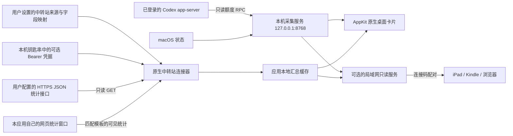

# 架构

原生应用负责生命周期、菜单和可拖动的桌面卡片。这是独立的 AppKit 应用，不使用系统 WidgetKit 组件选择器。Codex/Mac 服务和设备共享服务是不同进程：前者一直保持回环绑定，后者在用户开启共享后才绑定指定私网地址。退出时仅停止本应用拥有的进程；本机已有且身份校验通过的采集服务可以复用。

## 中转站连接

默认没有预配置站点。用户在“中转站设置…”选择 API JSON 或网页统计模板，填写显示名称、周期和 URL。

API 模式仅发起 HTTPS GET 统计请求，将响应按照字段映射规范化。可选 Bearer 凭据由钥匙串管理，不放入配置或汇总。网页模式在自有 WebKit 窗口内登录，只支持当前模板能识别的统计页；没有真实 Token 的页面不能产生 Token 数字。

每次更换配置都使用新的连接标识并清除旧来源读数。异步回调与缓存必须匹配当前连接标识，防止旧站点的晚到响应覆盖新配置。连接 URL、字段映射、认证上下文和完整原始响应不进入共享数据。

## 数据与状态

缓存只保存筛选后的统计字段、连接标识和原始采集时间。WebKit 会话与缓存分开；诊断信息使用简短阶段和原因，不记录凭据或完整页面。

Token、调用次数、美元费用是不同指标。总 Token 优先使用来源直接提供的有效值，只有输入与输出均已知时才允许相加。任一 Key 缺少相关字段时，该字段的整体合计不能使用其他 Key 的部分和代替。适配器成功确认的空列表可显示零；未连接、读取失败和未知字段不能变成零。

页面每次渲染都会分别判断各来源的新旧状态。账号及中转站读数通常超过 360 秒标为历史读数，Mac 状态超过 60 秒标为历史读数。页面刷新时间不能替代来源的采集时间。失联后保留已知明细及原时间，不把读缓存的时间写成新采集时间。

普通显示和墨水屏显示均服务端渲染。普通页面的脚本只做可选增强，墨水屏页面完全不包含脚本。网页不保证阻止设备休眠，也不会强行修改设备电源设置。
