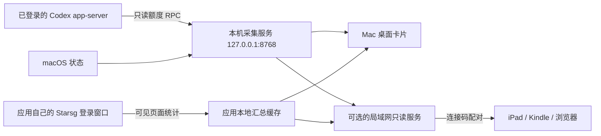

# 架构

原生应用负责生命周期与界面。Codex/Mac 服务和设备共享服务是不同进程：前者一直保持回环绑定，后者在用户开启共享后才绑定指定私网地址。退出时仅停止本应用拥有的进程；本机已有且身份校验通过的采集服务可以复用。

WebKit 会话与用量缓存分开。缓存只保存统计字段和原始采集时间；诊断文件只保存阶段、简短原因与已知页面路径，不保存查询参数、完整页面或登录信息。

页面每次渲染都会分别判断各来源的新旧状态。账号及 Starsg 读数通常超过 360 秒标为历史读数，Mac 状态超过 60 秒标为历史读数。页面刷新时间不能替代来源的采集时间。失联后不将旧数字归零，也不把读缓存的时间写成新采集时间。

普通显示和墨水屏显示均服务端渲染。普通页面的脚本只做可选增强，墨水屏页面完全不包含脚本；设备休眠不由网页强行绕过。
